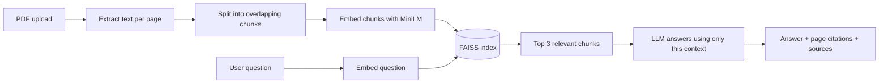

A Retrieval-Augmented Generation (RAG) app that lets you upload any text-based PDF and ask questions about it. Every answer is generated **only from the document** and cites the **page numbers** it came from, with the matching source passages shown underneath.

I built this as a learning project in AI engineering to understand the full RAG pipeline end to end: chunking, embeddings, vector search, and grounded LLM answers.

---

## 🖼️ Screenshots

**1. Start screen**


**2. Choose a PDF**


**3. The PDF is chunked and indexed, and the app is ready for questions**


**4. Answer with page citations and source passages**


---

## ✨ Features

- Upload any text-based PDF through a simple web interface
- Automatic text extraction, chunking and indexing
- Semantic search (finds meaning, not just keywords)
- Answers grounded in the document, with **page citations**
- Shows the **top 3 source passages** and similarity scores, so you can verify every answer
- Says *"I couldn't find that in the document"* instead of guessing

---

## 🧠 How it works



1. **Extract:** `pypdf` reads the text of each page.
2. **Chunk:** the text is split into 800-character chunks with 150 characters of overlap, so ideas that cross a boundary aren't lost. Each chunk remembers its page number.
3. **Embed:** `all-MiniLM-L6-v2` turns every chunk into a normalized vector.
4. **Index and search:** FAISS (`IndexFlatIP`) finds the 3 chunks most similar to the question (cosine similarity, since vectors are normalized).
5. **Generate:** the retrieved chunks and the question go to an LLM on Groq (`openai/gpt-oss-120b`) with `temperature=0` and a prompt that tells it to answer only from the context and cite pages.
6. **Show:** the Gradio UI displays the answer and the sources it used.

---

## 🧰 Tech stack

| Part | Tool |
|---|---|
| PDF parsing | pypdf |
| Embeddings | sentence-transformers (`all-MiniLM-L6-v2`) |
| Vector search | FAISS |
| LLM | Groq API (`openai/gpt-oss-120b`) |
| Interface | Gradio |
| Environment | Google Colab |

---

## 🚀 Getting started

### Run it in Google Colab

1. Click the **Open in Colab** badge at the top of this page.
2. Get a free API key from [console.groq.com](https://console.groq.com) (sign up, then **API Keys → Create API Key**).
3. In Colab, click the **🔑 Secrets** icon in the left sidebar and add a secret named `GROQ_API_KEY` with your key as the value. Turn on **Notebook access**.
4. Run the cells from top to bottom. The last cell starts the app and prints a link (`https://....gradio.live`).
5. Open the link, upload a PDF, wait for the **Ready** message, and ask your question.

> ⚠️ Never paste your API key directly into the notebook or commit it to GitHub.

### Changing the model

The model name is stored in one variable at the top of the code:

```python
LLM_MODEL = "openai/gpt-oss-120b"
```

Model names on hosted APIs change over time. If you get a "model not found" error, check [Groq's models page](https://console.groq.com/docs/models) and update this line.

---

## 💡 Example

Using a 30-page "AI & Machine Learning" guide (99 chunks), I asked:

> **what is neural network**

The app answered with a definition built from page 13 of the document and listed the three most relevant passages (pages 13, 3 and 3) with their similarity scores.

---

## ⚠️ Limitations

- Works only with PDFs that contain selectable text. Scanned PDFs would need OCR.
- One PDF at a time, and the index lives in memory for the session only.
- Fixed-size chunking can split sentences; semantic chunking would be better.
- Retrieval uses simple top-k similarity, with no reranking yet.
- The app runs while the Colab notebook is running. It is not permanently hosted.

## 🛣️ Roadmap

- [ ] Add OCR support for scanned PDFs
- [ ] Add a reranker to improve retrieval quality
- [ ] Support multiple PDFs at once
- [ ] Add a small evaluation set to measure answer accuracy
- [ ] Deploy as a permanent web app
- [ ] Extend the same pipeline to question answering over GitHub codebases

---

## 👤 Author

**Devesh Nebhani**
[LinkedIn](https://www.linkedin.com/in/devesh-nebhani-b2980522b/) · [GitHub](https://github.com/devesh-commits-ai)

If you have feedback or suggestions, feel free to open an issue. I'm still learning and would love to hear them. ⭐ A star on the repo is appreciated!
